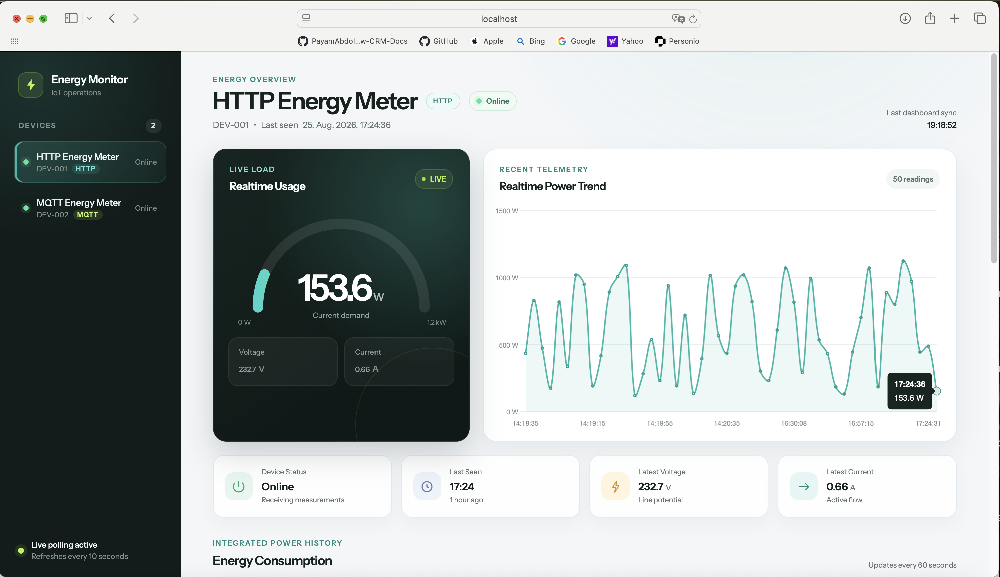
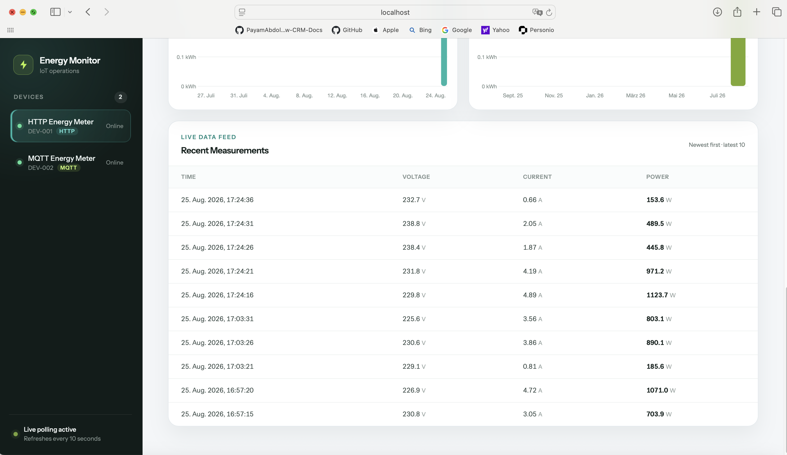
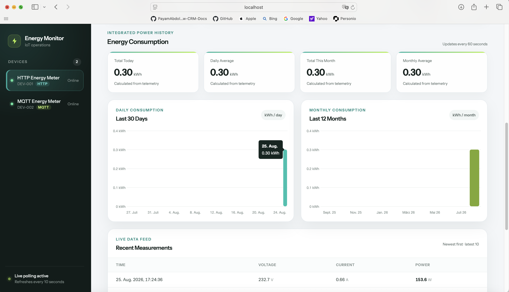

# IoT Energy Monitor

IoT Energy Monitor is a Laravel-based energy monitoring platform that demonstrates two device communication patterns in one application. An HTTP meter authenticates with a per-device API key, while an MQTT meter publishes through Eclipse Mosquitto. Both paths validate and store voltage, current, power, and measurement timestamps through the same transactional ingestion service.

The application stores time-series measurements in MySQL, derives energy consumption in kWh, and presents device-specific realtime and historical data in a responsive dashboard. The browser reads Laravel APIs only; it never connects directly to MQTT.



The shared dashboard monitors `DEV-001` over HTTP and `DEV-002` over MQTT while keeping each device's measurements and energy analytics independent.

## Features

- HTTP measurement ingestion with per-device `X-Device-Key` authentication
- MQTT ingestion through a local Eclipse Mosquitto broker
- Long-running Laravel `mqtt:consume` Artisan command
- Shared, transactional `MeasurementIngestionService` for both transports
- Explicit HTTP/MQTT transport enforcement per device
- Isolated measurement history, latest readings, and analytics per device
- Voltage, current, instantaneous power, and timestamp storage
- Device status and `last_seen_at` updates after successful ingestion
- Paginated measurement history with optional date filters
- Trapezoidal power-to-energy integration with configurable gap handling
- Today, daily-average, current-month, and monthly-average kWh metrics
- Last 30 days and last 12 months energy series
- Responsive Blade and Chart.js dashboard with automatic polling
- Standalone HTTP/MQTT device simulator with continuous and bounded modes
- Docker Compose environment for PHP-FPM, Nginx, MySQL, and Mosquitto
- Unit and feature tests for ingestion, authentication, analytics, isolation, and dashboard behavior

Successful ingestion marks a device as `online` and updates `last_seen_at`. Devices start as `offline`; the current application does not run a background process that automatically marks stale devices offline.

## Architecture

```text
DEV-001: HTTP Energy Meter
        |
        | HTTP JSON + X-Device-Key
        v
Laravel REST API
        |
        v
AuthenticateDevice middleware
        |
        v
MeasurementIngestionService -----------+
                                        |
                                        v
                                      MySQL
                                        ^
                                        |
MeasurementIngestionService -----------+
        ^
        |
MqttMeasurementHandler
        ^
        |
Laravel: php artisan mqtt:consume
        ^
        |
Eclipse Mosquitto
        ^
        | MQTT publish
        |
DEV-002: MQTT Energy Meter


MySQL
  |
  +--> Device and measurement read APIs --> Dashboard
  |
  +--> EnergyAnalyticsService -----------> Dashboard
```

HTTP authentication and MQTT topic handling remain transport-specific. Once a message has been authenticated or accepted, both paths call `MeasurementIngestionService`. This keeps device association, timestamp normalization, measurement creation, status changes, and `last_seen_at` updates in one database transaction instead of duplicating storage logic.

## Demo Devices

The database seeder creates or updates two local demo devices:

| Device | Name | Transport | Authentication |
|---|---|---|---|
| `DEV-001` | HTTP Energy Meter | HTTP | `X-Device-Key` |
| `DEV-002` | MQTT Energy Meter | MQTT | MQTT broker connection |

Transport enforcement prevents `DEV-001` from ingesting through MQTT and prevents `DEV-002` from ingesting through the HTTP endpoint. The MQTT device has no HTTP API key.

## HTTP Ingestion

### Endpoint

```http
POST /api/v1/measurements
```

### Request payload

```json
{
  "device_id": "DEV-001",
  "voltage": 230.4,
  "current": 2.8,
  "power": 645.1,
  "timestamp": "2026-08-25T14:30:00Z"
}
```

### Example request

```bash
curl --request POST http://localhost:8081/api/v1/measurements \
  --header 'Accept: application/json' \
  --header 'Content-Type: application/json' \
  --header 'X-Device-Key: YOUR_DEVICE_API_KEY' \
  --data '{
    "device_id": "DEV-001",
    "voltage": 230.4,
    "current": 2.8,
    "power": 645.1,
    "timestamp": "2026-08-25T14:30:00Z"
  }'
```

Replace `YOUR_DEVICE_API_KEY` with the local key configured for `DEV-001`. Do not reuse development credentials in production.

### HTTP responses

| Status | Meaning |
|---|---|
| `201 Created` | Measurement stored; device marked online |
| `401 Unauthorized` | Missing or invalid device API key |
| `403 Forbidden` | A valid API key belongs to a different HTTP device |
| `404 Not Found` | Requested device UID does not exist |
| `409 Conflict` | Device exists but is configured for MQTT ingestion |
| `422 Unprocessable Content` | Payload validation failed |

Required payload fields are `device_id`, `voltage`, `current`, `power`, and `timestamp`. Numeric readings must be zero or greater, and the timestamp must be a valid date.

## MQTT Ingestion

MQTT device identity comes from the topic rather than the JSON payload.

### Topic pattern

```text
devices/{device_uid}/measurements
```

DEV-002 publishes to:

```text
devices/DEV-002/measurements
```

### Payload

```json
{
  "voltage": 230.4,
  "current": 2.8,
  "power": 645.1,
  "timestamp": "2026-08-25T14:30:00Z"
}
```

```text
Device
  --> MQTT publish
  --> Mosquitto
  --> Laravel MQTT consumer
  --> MqttMeasurementHandler
  --> MeasurementIngestionService
  --> MySQL
```

The local broker is reachable at `localhost:1883` from the host and `mosquitto:1883` from Docker services.

## MQTT Consumer

Start the consumer in a dedicated terminal:

```bash
docker compose exec php php artisan mqtt:consume
```

The command connects using `config/mqtt.php` and subscribes at QoS 0 to:

```text
devices/+/measurements
```

`MqttMeasurementHandler` rejects and logs:

- malformed topics
- invalid JSON or non-object payloads
- negative or non-numeric measurements
- invalid timestamps
- unknown device UIDs
- messages for devices not configured for MQTT

Rejected messages are not stored and do not terminate the consumer. Press `Ctrl+C` to interrupt the loop and disconnect cleanly.

## Dashboard

Open:

```text
http://localhost:8081/dashboard
```

The dashboard includes:

- device selection with HTTP/MQTT transport badges
- online/offline state and last-seen time
- latest voltage, current, and power
- gauge-style realtime power display
- recent power trend chart
- latest 10 measurements table
- total energy today and daily average
- total energy this month and monthly average
- last 30 days daily energy chart
- last 12 months monthly energy chart

Users can switch between the HTTP and MQTT devices from the sidebar. Every dashboard panel updates to the selected device, including realtime values, measurement history, and energy analytics.

Realtime values and history refresh every 10 seconds, the device list every 30 seconds, and energy analytics every 60 seconds while the page is visible. Device changes cancel or ignore stale requests so readings from the previous selection are not rendered.

All dashboard data comes from Laravel read APIs. MQTT credentials and broker connections are never sent to browser code.

### Recent Measurements



The recent measurements table shows the timestamp, voltage, current, and power of the latest telemetry for the selected device. Records remain isolated between `DEV-001` and `DEV-002`.

## Energy Analytics

Measurements contain instantaneous power in watts. `EnergyAnalyticsService` combines consecutive samples with their elapsed time using trapezoidal integration:

```text
Power samples (W) + elapsed time
              --> energy (Wh)
              --> energy (kWh)
```

The service groups energy by calendar day and month using `APP_TIMEZONE`. It does not extrapolate from a single sample. If two consecutive measurements are farther apart than `ENERGY_MAX_INTEGRATION_GAP_SECONDS`, that interval is skipped rather than treated as continuous consumption. The default threshold is 300 seconds.

Daily and monthly averages include only periods with usable measurement intervals.

The dashboard presents Total Today, Daily Average, Total This Month, and Monthly Average summaries alongside Last 30 Days and Last 12 Months energy charts.



## Technology Stack

| Area | Technology |
|---|---|
| Backend | PHP 8.3, Laravel 13 |
| Database | MySQL 8.4 |
| Web server | Nginx with PHP-FPM |
| MQTT broker | Eclipse Mosquitto 2.0 |
| MQTT client | `php-mqtt/client` |
| Frontend | Blade, vanilla JavaScript, Chart.js 4 |
| Styling/build | Tailwind CSS 4, Vite 8 |
| Containerization | Docker, Docker Compose |
| Testing | PHPUnit 12, Laravel unit and feature tests |

## Local Installation

### Prerequisites

- Docker Desktop with Docker Compose
- PHP 8.3 or newer on the host for the standalone simulator
- Node.js and npm for frontend assets
- Git

### 1. Clone the repository

```bash
git clone git@github.com:PayamAbdolmohammadi/iot-energy-monitor.git
cd iot-energy-monitor
```

### 2. Create the environment file

```bash
cp .env.example .env
```

The example environment configures Laravel to reach MySQL at `mysql:3306` and Mosquitto at `mosquitto:1883` over the Docker network. Adjust host ports or credentials in `.env` when necessary.

### 3. Build and start Docker

```bash
docker compose up -d --build
```

### 4. Install backend dependencies

```bash
docker compose exec php composer install
```

### 5. Generate the application key

```bash
docker compose exec php php artisan key:generate
```

### 6. Run migrations and seed the demo devices

```bash
docker compose exec php php artisan migrate --seed
```

This creates or updates `DEV-001` and `DEV-002` through `DemoDeviceSeeder`.

### 7. Install and build frontend assets

```bash
npm ci
npm run build
```

The application is then available at `http://localhost:8081` using the default `.env.example` ports.

### Configuration reference

| Variable | Purpose | Default in `.env.example` |
|---|---|---|
| `APP_PORT` | Nginx host port | `8081` |
| `APP_TIMEZONE` | API date presentation and analytics calendar boundaries | `UTC` |
| `DB_HOST` | MySQL hostname inside Docker | `mysql` |
| `DB_FORWARD_PORT` | MySQL host port | `3306` |
| `MQTT_HOST` | Broker hostname used by Laravel | `mosquitto` |
| `MQTT_PORT` | MQTT TCP port | `1883` |
| `MQTT_CLIENT_ID` | Laravel consumer client ID | `iot-energy-monitor-backend` |
| `MQTT_USERNAME` / `MQTT_PASSWORD` | Optional broker credentials | empty |
| `ENERGY_MAX_INTEGRATION_GAP_SECONDS` | Largest interval eligible for integration | `300` |
| `DOCKER_UID` / `DOCKER_GID` | Bind-mount ownership for macOS development | `501` / `20` |

## Running the Demo

The simulator generates a measurement every five seconds. Omit `--count` to run continuously, or pass `--count=N` for a bounded run.

### Terminal 1 — MQTT consumer

```bash
docker compose exec php php artisan mqtt:consume
```

### Terminal 2 — HTTP device

```bash
IOT_SIMULATOR_API_KEY=YOUR_DEVICE_API_KEY \
php tools/device-simulator.php \
  --transport=http \
  --device-id=DEV-001
```

### Terminal 3 — MQTT device

```bash
php tools/device-simulator.php \
  --transport=mqtt \
  --device-id=DEV-002
```

### Browser

```text
http://localhost:8081/dashboard
```

DEV-001 should receive measurements through authenticated HTTP requests. DEV-002 should receive measurements published through Mosquitto and processed by the Laravel consumer. Both devices appear independently in the same dashboard and share the same storage and analytics implementation.

Run `php tools/device-simulator.php --help` to see all CLI options and corresponding environment variables.

## Useful Commands

| Task | Command |
|---|---|
| Start containers | `docker compose up -d` |
| Rebuild and start | `docker compose up -d --build` |
| Stop containers | `docker compose down` |
| Show service status | `docker compose ps` |
| Run migrations and seeders | `docker compose exec php php artisan migrate --seed` |
| Start MQTT consumer | `docker compose exec php php artisan mqtt:consume` |
| Run all tests | `docker compose exec php php artisan test` |
| Format PHP | `docker compose exec php ./vendor/bin/pint` |
| Build frontend | `npm run build` |
| Watch Mosquitto logs | `docker compose logs -f mosquitto` |
| Watch Laravel logs | `docker compose exec php tail -f storage/logs/laravel.log` |
| Show simulator options | `php tools/device-simulator.php --help` |

## API Overview

The current API routes are:

| Method | Endpoint | Authentication | Purpose |
|---|---|---|---|
| `POST` | `/api/v1/measurements` | `X-Device-Key` | Ingest an HTTP device measurement |
| `GET` | `/api/v1/devices` | None | List devices, transport, status, and last seen |
| `GET` | `/api/v1/devices/{device}/latest` | None | Return the device's latest measurement |
| `GET` | `/api/v1/devices/{device}/measurements` | None | Return newest-first, paginated measurement history |
| `GET` | `/api/v1/devices/{device}/energy-summary` | None | Return kWh summary and historical series |

`{device}` uses the public `device_uid`, such as `DEV-001`. Measurement history returns 50 items per page and accepts optional `from` and `to` date query parameters:

```text
/api/v1/devices/DEV-001/measurements?from=2026-08-25T10:00:00Z&to=2026-08-25T12:00:00Z
```

Read endpoints are intentionally unauthenticated in this local MVP. User authentication is not implemented.

## Testing

Run the complete suite with:

```bash
docker compose exec php php artisan test
```

The automated suite covers:

- HTTP API-key authentication and response behavior
- HTTP payload validation and measurement ingestion
- MQTT topic parsing, payload validation, and recovery after rejected messages
- HTTP/MQTT transport enforcement
- shared transactional ingestion behavior
- model relationships, casts, and cascading deletion
- device ownership and read API isolation
- pagination and date filtering
- trapezoidal energy integration and gap handling
- timezone-aware daily and monthly analytics
- demo device seeding
- dashboard availability and API-key secrecy

## Security and Development Notes

- `Device` hides `api_key`, and API resources never return it.
- `.env`, `.env.backup`, and `.env.production` are ignored by Git.
- The simulator does not print HTTP API keys or MQTT passwords.
- Browser code receives no device API keys, MQTT credentials, or broker connection.
- Mosquitto anonymous access is enabled only in `docker/mosquitto/mosquitto.conf` for local development.
- Production MQTT deployments should require authentication, topic ACLs, TLS, and a hardened persistent broker configuration.
- The seeded DEV-001 key is a local demonstration credential, not a production secret.
- Dashboard and read API user authentication are not implemented yet.

## Project Structure

```text
app/
├── Console/Commands/
│   └── ConsumeMqttMeasurements.php
├── Enums/
│   └── DeviceTransport.php
├── Http/
│   ├── Controllers/Api/V1/
│   ├── Middleware/AuthenticateDevice.php
│   ├── Requests/Api/V1/
│   └── Resources/Api/V1/
├── Models/
│   ├── Device.php
│   └── Measurement.php
└── Services/
    ├── EnergyAnalyticsService.php
    ├── MeasurementIngestionService.php
    └── Mqtt/
        └── MqttMeasurementHandler.php

database/
├── migrations/
└── seeders/
    └── DemoDeviceSeeder.php

docker/
├── mosquitto/mosquitto.conf
├── nginx/default.conf
└── php/Dockerfile

resources/
├── css/app.css
├── js/app.js
└── views/dashboard.blade.php

tools/
└── device-simulator.php
```

## Design Decisions

1. **One ingestion service for both transports.** HTTP and MQTT delegate validated messages to `MeasurementIngestionService`, keeping persistence and device-state changes consistent.
2. **Transport concerns stop at the boundary.** HTTP authentication belongs to middleware; MQTT topic parsing and message validation belong to `MqttMeasurementHandler`. The shared service stays transport-agnostic.
3. **The dashboard is transport-agnostic.** It reads device-scoped HTTP APIs regardless of how each measurement arrived.
4. **Device ownership scopes every query.** Relationships and route-model binding by `device_uid` prevent measurement history and analytics from being mixed between devices.
5. **MQTT is server-side only.** Mosquitto communicates with the Laravel consumer, not with browser JavaScript.
6. **Analytics use stored measurements.** Energy calculations operate identically on HTTP- and MQTT-originated data and do not maintain separate aggregate tables.
7. **Large telemetry gaps are not extrapolated.** Skipping intervals above a configurable threshold avoids overstating energy consumption during outages or missing data.

## Future Improvements

- MQTT authentication, per-device topic ACLs, and TLS certificates
- production broker persistence and operational monitoring
- device provisioning and API-key rotation workflows
- queue-backed or horizontally scalable MQTT processing
- WebSockets or Server-Sent Events for push-based dashboard updates
- alerting and notification rules
- automatic stale-device/offline detection
- purpose-built time-series storage or precomputed aggregates at larger scale
- user authentication and dashboard authorization

These are potential extensions and are not part of the current implementation.

## License

No standalone `LICENSE` file has been added to the repository. Repository licensing should be clarified before redistribution.
